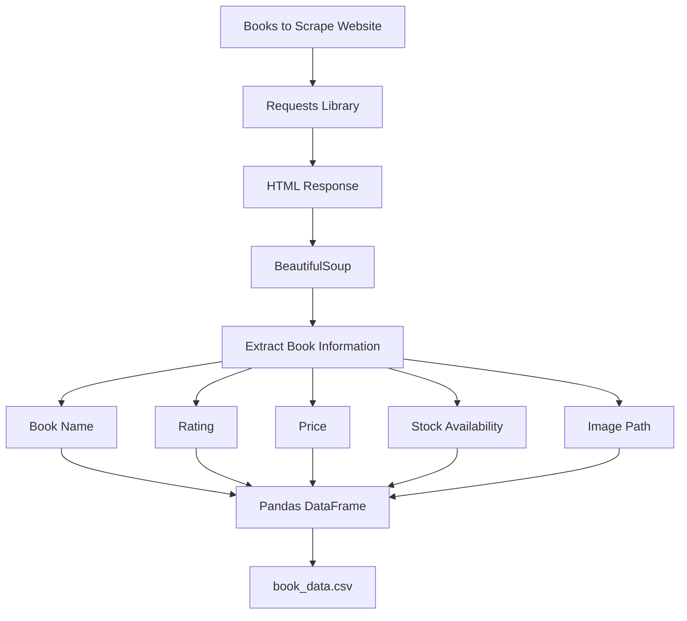

# 📚 Book Web Scraper

### A Python-Based Web Scraping Project Using BeautifulSoup and Pandas

Book Web Scraper is a Python web scraping project designed to extract book information from [Books to Scrape](https://books.toscrape.com/). It collects book names, ratings, prices, stock availability, and image paths from the website and organizes the extracted information into a structured dataset.

The project uses Python, Requests, BeautifulSoup, NumPy, and Pandas to retrieve, parse, process, and export website data into a CSV file for further analysis.

## 🚀 How to Use

### Prerequisites

Make sure you have installed:

- Python 3.10+
- Git

### 1. Clone the Repository

```bash
git clone https://github.com/hmzsrx/book-web-scrape.git
cd book-web-scrape
```

### 2. Create Virtual Environment

**Windows:**

```bash
python -m venv venv
venv\Scripts\activate
```

**Mac/Linux:**

```bash
python3 -m venv venv
source venv/bin/activate
```

### 3. Install Dependencies

```bash
pip install requests beautifulsoup4 pandas numpy lxml
```

### 4. Run the Scraper

```bash
python main.py
```

### 5. Get the Extracted Data

After successful execution, the scraped book information will be saved in:

```text
book_data.csv
```

You can open this CSV file using Microsoft Excel, Google Sheets, or Python Pandas.

## 🏗️ Project Architecture

The scraper follows a simple data extraction workflow:



### Technology Stack

| Technology | Purpose |
|---|---|
| Python | Main programming language |
| Requests | Fetch website HTML |
| BeautifulSoup | Parse and extract HTML data |
| lxml | HTML parsing |
| Pandas | Organize extracted data |
| NumPy | Numerical data processing |
| CSV | Export scraped data |

## ✨ Key Features

- Extract book information from a website.
- Collect book titles and names.
- Extract book ratings.
- Retrieve book prices.
- Check stock availability.
- Extract book image paths.
- Parse HTML using BeautifulSoup.
- Organize extracted data using Pandas DataFrame.
- Export results into CSV format.

## 👨‍💻 Contributing

Contributions are welcome!

1. Fork the repository.
2. Create a new branch for your changes.
3. Implement your improvements.
4. Test the scraper.
5. Commit and push your changes.
6. Submit a Pull Request.

Please maintain clean code and follow the existing project structure.

## ⚠️ Known Issues & Future Improvements

Potential improvements:

- Scrape all available pages using pagination.
- Improve price extraction and formatting.
- Download book images locally.
- Add error handling for failed requests.
- Add support for configurable website URLs.
- Store scraped data in a database.
- Add automated scraping schedules.
- Introduce data visualization and analysis.

## ⭐ Support

If you find this project useful, consider giving this repository a ⭐ on GitHub.

Your support and contributions are appreciated!

---

**Built with ❤️ using Python, Requests, BeautifulSoup, and Pandas.**
